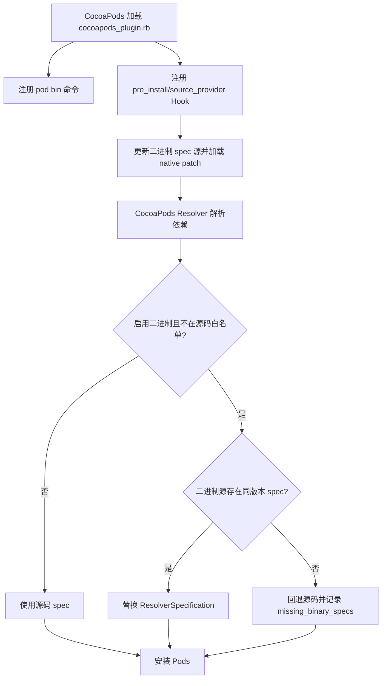
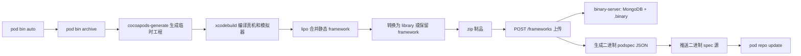

# 架构设计

## 目标与边界

系统面向 iOS CocoaPods 工程，通过“源码 spec 源 + 二进制 spec 源 + 二进制制品服务”实现依赖形态切换。二进制 spec 必须与源码 spec 及服务端 zip 使用相同组件名和版本，否则解析器会回退源码或下载失败。当前构建链不支持 macOS、watchOS 等平台的完整打包流程。

## 仓库级组成

| 目录 | 职责 |
| --- | --- |
| `cocoapods-imy-bin/` | Ruby 插件、CocoaPods Hook、构建和发布命令 |
| `binary-server/` | Koa HTTP API、MongoDB 元数据和本地 zip 存储 |
| `apps/IMYBinManager/` | SwiftUI 桌面端、环境诊断、任务编排和制品浏览 |
| `docs/` | 架构、运维、兼容性与应用设计文档 |

## 代码分层

| 目录/文件 | 职责 |
| --- | --- |
| `lib/cocoapods_plugin.rb` | CocoaPods 自动加载入口 |
| `command/bin/` | `pod bin` 子命令与流程编排 |
| `source_provider_hook.rb` | 注册 `pre_install` 和 `source_provider` Hook |
| `native.rb`、`native/` | 对 CocoaPods、Xcodeproj 和 generate 的兼容性覆写 |
| `helpers/` | 编译、压缩、spec 转换及上传 |
| `config/` | 用户级配置和构建产物路径 |

`Pod.match_version?('~> 1.4')` 的语义是 `>= 1.4` 且 `< 2.0`，因此 CocoaPods 1.x 都会加载大部分 native patch。修改 `native/` 前必须比对目标 CocoaPods 版本中的原始方法签名和行为。

## 插件加载与安装流程

`source_provider` Hook 把源码源加入解析上下文；启用二进制时，二进制源排在源码源之前。`pre_install` Hook 会执行二进制源更新、把 `:path` 本地依赖加入源码白名单，并在存在时通过 `eval` 合并工程根目录的 `BinPodfile`。因此 `BinPodfile` 只能来自可信仓库。

真正的 spec 替换位于 `native/resolver.rb#resolver_specs_by_target`。二进制 spec 缺失或读取失败时，组件被加入 `Archive.missing_binary_specs`；`pod bin archive --all-make` 会尝试补建这些依赖。

## 构建与发布流程

默认工作根目录为 `/private/var/tmp/imy_release/<组件工程>-build-temp/`，包含：

- `bin-archive/`：`cocoapods-generate` 生成的临时工程；
- `bin-zip/`：framework、静态库及压缩包；
- `bin-spec/`：缺失二进制组件的源码 podspec 缓存；
- `bin-json/`：转换后的二进制 podspec JSON。

固定临时根路径用于让不同机器上的 DWARF 编译目录保持可重建，从而支持 `pod bin code` 创建源码软链接。改变路径策略时，需要同时验证 archive 和源码断点调试。

## 关键设计约束

1. 源码源和二进制源必须包含相同版本；版本发布、制品上传和 spec 推送应视为一个事务。
2. `native/` 直接覆写 CocoaPods 内部实现，不属于稳定插件 API；升级 CocoaPods 必须执行回归测试。
3. 二进制 spec 会删除或重写 `source_files`、`public_header_files`、`vendored_libraries`、资源和 `prepare_command` 等字段；复杂 subspec 必须单独验证。
4. 当前构建实现仅处理 iOS，真机为 `arm64`，模拟器为 `x86_64`，产物不是 XCFramework。
5. 上传采用外部 `curl` 命令，仓库内 `binary-server/` 实现了约定的 multipart 接口；当前插件没有使用 `curl --fail`，服务端也可能以 HTTP 200 返回错误文本，两端都需改造后才能可靠供 CI 判定失败。
6. 服务端的 MongoDB 记录和 `.binary/` 文件必须一致；上传、删除和备份都应按一个事务设计。当前实现尚未满足这一约束。
