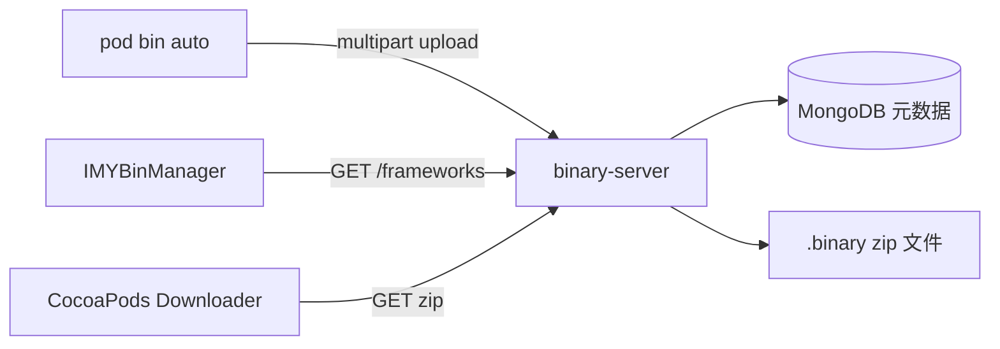

# 二进制服务端

## 系统职责

`binary-server/` 是 `cocoapods-imy-bin` 配套的制品服务，不是独立示例。Ruby 插件通过 `POST /frameworks` 上传 zip，并把 `GET /frameworks/:name/:version/zip` 写入二进制 podspec。服务端把组件元数据写入 MongoDB，把文件保存在进程目录下的 `.binary/<name>/<version>/`。



## 启动与验证

当前实现要求本机 MongoDB，连接固定为 `mongodb://localhost/binary_database`，监听端口固定为 `8080`：

```bash
cd binary-server
npm install
npm start

curl --fail http://localhost:8080/frameworks
```

返回值应为 `{组件名: [版本]}`，例如 `{"PodA":["0.2.4"]}`。插件配置必须保持以下路径模板，否则其上传 URL 推导逻辑会失效：

```yaml
binary_download_url: http://localhost:8080/frameworks/%s/%s/zip
download_file_type: zip
```

## HTTP 协议

| 方法与路径 | 用途 |
| --- | --- |
| `GET /frameworks` | 列出全部组件及版本 |
| `GET /frameworks/:names` | 按逗号分隔的组件名查询 |
| `GET /frameworks/:name/:version` | 查询指定版本是否存在 |
| `GET /frameworks/:name/:version/zip` | 下载制品 |
| `POST /frameworks` | 上传 `name`、`version`、`file`，可附带 `annotate`、`sha` |
| `DELETE /frameworks/:name/:version` | 删除制品；当前实现存在误删风险，禁止用于生产 |

## 当前风险与改造顺序

服务端依赖来自 2018 年，尚无自动化测试、认证、限流、TLS、制品哈希校验或统一错误 JSON。当前删除逻辑会删除组件的整个目录，而不只是指定版本；上传也没有等待文件写完，并且没有持久化 `annotate`、`sha`。因此只能在可信的本地或隔离网络用于联调，不应直接暴露到公网。

生产化应优先：修复版本级删除与原子上传；增加输入、zip 和 SHA-256 校验；补健康检查、结构化错误和 API 测试；通过环境变量配置端口、MongoDB 与存储目录；最后再加入身份认证、权限审计、对象存储和备份。桌面端当前只调用列表接口，不执行上传或删除。
