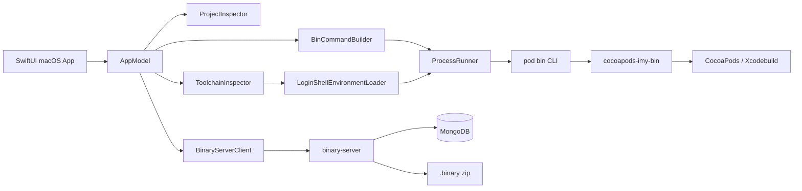

# macOS 应用设计

## 产品定位

目标是把 `cocoapods-imy-bin` 的命令行能力包装成可观察、可取消、可审计的 macOS 桌面工具，降低 Ruby 环境、私有源配置和长时间构建任务的使用门槛。应用暂名 **IMYBinManager**。

对 `/Applications/MTool.app` 的只读分析显示，它是 x86_64 AppKit 应用，包含模块检索、版本选择、分支/标签切换、集成与发布、缓存清理、日志、文件上传等页面，并通过 `biu`、`biupod`、`biugit` 等外部 CLI 完成实际工作。这验证了“GUI 负责编排，CLI 负责执行”的路线。MTool 的内部 CLI、接口、品牌和素材不属于本项目；本仓库自己的 `binary-server/` 则是桌面端应正式接入的配套服务。

## MVP 范围

第一阶段只覆盖当前插件已经具备的能力：

- 选择 CocoaPods 工程并扫描 `Podfile`、`Podfile.lock`、`BinArchive.json` 和 podspec；
- 从登录 shell 读取 Ruby 工具链环境，展示 Ruby、Bundler、CocoaPods 和 Xcode 状态；
- 通过参数数组运行 `pod bin install`、`pod bin update` 和 `pod bin archive`；
- 支持环境、构建配置、`--all-make`、`--no-clean` 等选项；
- 实时展示 stdout/stderr，支持取消任务；
- 配置 `binary-server` 地址，检测连接并只读浏览组件与版本；
- 所有外部副作用由用户点击触发，不在启动或扫描阶段自动执行。

`pod bin auto` 涉及上传和 spec push，第一阶段不放入主操作区。待加入凭据管理、确认页、制品摘要和失败回滚后再开放。

## 技术架构

采用原生 SwiftUI + Swift Package Manager，最低 macOS 13。App 不嵌入 Ruby，也不直接调用 CocoaPods 私有 Ruby API；它解析登录 shell 的 `PATH`、`GEM_HOME`、`GEM_PATH` 等必要变量，定位实际 `pod` 后使用 `Foundation.Process` 执行。参数不拼接成 shell 字符串，工程路径和 podspec 路径可以安全包含空格。

当前代码放在 `apps/IMYBinManager/`：

- `IMYBinCore`：工程扫描、命令建模、环境探测和进程执行；
- `BinaryServerClient`：规范化服务 URL、解析 `{组件名: [版本]}` 协议和处理 HTTP 错误；
- `IMYBinManager`：SwiftUI 页面与状态管理；
- `IMYBinCoreTests`：不依赖真实私有源的单元测试；
- `Scripts/package_app.sh`：将 release 可执行文件封装为本地 `.app`。

## 安全边界

- 工程扫描只读；install、update、archive 必须由用户主动点击。
- 不读取或展示 Keychain 内容，不把密码放入命令行参数和日志。
- 不复用 MTool 内的 HTTP 地址、Cookie、资源文件或反编译代码；只连接用户配置的本项目 `binary-server`。
- MVP 不开启 App Sandbox，因为 CocoaPods/Xcode 需要访问用户选择的工程、缓存、私有仓库和开发工具。正式分发前应启用 Hardened Runtime、Developer ID 签名和公证，并重新评估最小权限。
- 后续接入发布服务时，令牌存储在 Keychain，HTTP 客户端强制 HTTPS，并为发布动作增加二次确认和幂等键。

## 演进路线

1. **MVP**：本地工程、工具链探测、install/update/archive、日志与取消。
2. **组件工作台**：解析 Lockfile 与 podspec，展示源码/二进制状态、版本差异和缺失制品。
3. **制品发布**：先生产化改造 `binary-server`，再加入预检、构建、校验、上传、spec push、失败回滚和历史记录。
4. **团队平台**：在服务端扩展模块目录、权限、审批、CI 任务和通知，而不是把团队逻辑塞入桌面端。
5. **插件协议化**：为 Ruby CLI 增加 JSON Lines 事件输出，使 App 不再依赖自然语言日志解析。

## MVP 验收标准

- Finder 启动后能识别与终端一致的 Ruby/CocoaPods；
- 选择合法组件目录后能列出 podspec，非法目录给出明确提示；
- 命令预览与实际参数一致，路径中包含空格也能运行；
- 日志持续更新，取消后子进程退出且界面恢复可操作；
- 不提供私有源时仍可完成启动、扫描和单元测试；
- 输入可访问的服务地址后能展示组件与版本；服务不可用时给出 HTTP 或连接错误，且不影响本地构建功能；
- Swift `build` 与 `test` 在 CI 中通过，发布动作默认不可用。
