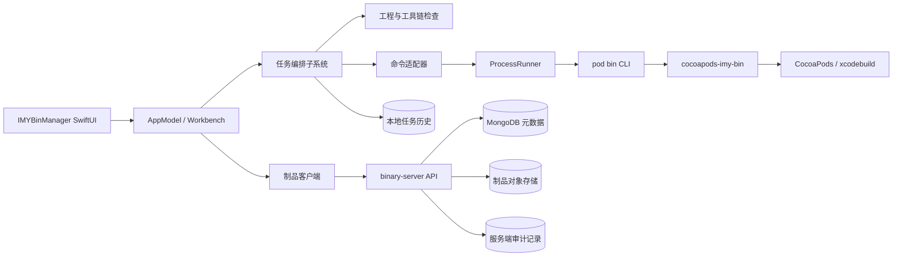
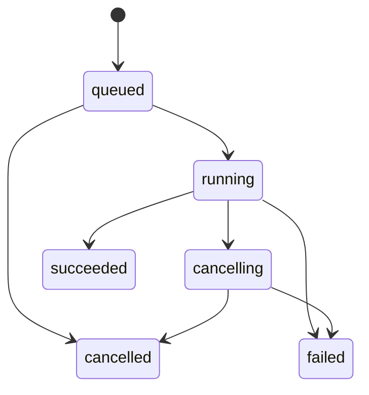

# 面向组件二进制化工作台的架构

> 状态：提案 / 第一阶段实施中  
> 更新日期：2026-09-08  
> 适用范围：`cocoapods-imy-bin`、`binary-server`、`apps/IMYBinManager`

## 1. 目标与边界

本项目建设一个面向 CocoaPods 组件二进制化的 macOS 工作台：开发者可在一个受控界面内完成工程检查、依赖安装/更新、二进制构建、源码调试、制品查询和后续的安全发布。

架构以本机可观察到的 MTool 工作流为参考：组件目录、依赖安装与缓存管理、源码切换、构建/上传、版本配置、任务日志和模块发布流程。实现遵循以下原则：

- **功能对齐，实现独立**：不复制 MTool 代码、资源、品牌、私有接口、Cookie 或内部服务协议。
- **CLI 是构建事实来源**：`cocoapods-imy-bin` 保持构建规则和 CocoaPods 兼容层；客户端只负责编排、展示和确认。
- **副作用显式化**：构建、上传、删除、spec push、Git tag 等操作都必须被建模为任务，记录发起者、输入、日志和结果。
- **发布默认收敛**：本地读取和构建优先；发布能力先完成预检、凭据保护、二次确认、审计和幂等，再开放入口。
- **可演进部署**：初期允许本地 `binary-server`；生产环境要求 HTTPS、鉴权、数据库备份和制品存储隔离。

### 非目标

- 不重建 MTool 的内部模块市场、即时通信、企业账号体系或私有 CI。
- 不在 macOS 客户端直接执行服务端文件写入、数据库操作或 Git 凭据管理。
- 不承诺在未验证前支持所有 Xcode、Apple Silicon、XCFramework 和 CocoaPods 版本组合。

## 2. 现状与缺口

| 能力 | 当前状态 | 下一步 |
| --- | --- | --- |
| 工程选择、工具链探测 | macOS 客户端已有 | 纳入工作区与健康检查模型 |
| `pod bin install/update/archive/code` | macOS 客户端已有基础调用 | 改为统一任务状态机和结构化事件 |
| CocoaPods 构建/兼容层 | Ruby 插件已有 | 增加 JSON Lines 事件协议和发布预检输出 |
| 制品列表查询 | `binary-server` 与客户端已有 | 建立版本详情、校验信息和健康接口 |
| 上传、删除、认证 | 服务端已有令牌保护与基础校验 | 接入受控发布编排、审计与幂等 |
| 发布、spec push、Git tag | CLI 可支持但客户端未开放 | 在发布子系统完成前保持禁用 |
| 任务历史、失败诊断 | 仅原始内存日志 | 首个子系统落地任务记录、事件与持久化 |

## 3. 逻辑架构



### 分层职责

| 层 | 模块 | 职责 | 禁止事项 |
| --- | --- | --- | --- |
| 交互层 | `IMYBinManager` | 工作台、确认页、进度、日志、错误恢复 | 直接拼接 shell 命令或保存服务端密钥 |
| 应用层 | `IMYBinCore` | 任务状态机、命令构建、工程快照、事件解析、历史存储 | 依赖 SwiftUI 或私有服务协议 |
| 构建层 | `cocoapods-imy-bin` | CocoaPods 兼容、构建、归档、源码连接、发布预检 | 处理 UI 状态或持久化用户凭据 |
| 服务层 | `binary-server` | 制品元数据、上传下载、版本删除、鉴权、校验、审计 | 执行任意客户端 shell 命令 |
| 基础设施 | MongoDB / 对象存储 / CI | 元数据、制品、备份、服务部署与监控 | 让客户端绕过 API 直接访问 |

## 4. 核心领域模型

### 4.1 本地工作区

`Workspace` 表示用户选择的组件工程，而不是任意文件夹。它保存根目录、Podfile、podspec、`BinArchive.json`、锁文件和最近检查结果。工程扫描只读；任何写入由一个显式任务执行。

### 4.2 任务

所有本地命令和远程发布流程统一表示为 `TaskRecord`：

| 字段 | 说明 |
| --- | --- |
| `id` | UUID，用于 UI、日志、审计和幂等关联 |
| `kind` | `inspect`、`install`、`update`、`archive`、`attachSource`、`publish`、`deleteArtifact` |
| `state` | `queued`、`running`、`cancelling`、`succeeded`、`failed`、`cancelled` |
| `workspaceURL` | 当前工程根目录；制品查询任务可为空 |
| `command` | 已解析的可展示命令，不包含密钥 |
| `startedAt` / `finishedAt` | 用于排序和耗时统计 |
| `exitCode` / `failureSummary` | 结果摘要 |
| `events` | 有序输出、阶段、警告和结果事件 |

允许的状态迁移：



任务历史默认保存在用户应用支持目录，仅保存脱敏命令、结构化摘要和有限长度日志。完整构建日志仍可导出为用户指定文件。

### 4.3 制品与发布单

`Artifact` 的身份为 `{component, version}`，附带 SHA-256、文件大小、上传时间、下载地址和构建环境摘要。`PublishPlan` 是尚未执行的发布意图，包含：

1. 工程与工具链检查结果；
2. 将要构建的 podspec、环境和配置；
3. 预期制品名称、版本和 SHA-256；
4. 上传、spec push、Git tag 的独立步骤；
5. 每一步的可逆性、幂等键和失败补偿策略。

只有通过预检并由用户在确认页明确执行后，`PublishPlan` 才能转为发布任务。

## 5. 接口与事件演进

### 5.1 Ruby CLI 与客户端

保持现有文本输出兼容，并新增可选 JSON Lines 事件模式：

```text
pod bin archive Demo.podspec --event-format=jsonl
```

示例事件：

```json
{"type":"phase","name":"resolve_dependencies","message":"解析依赖"}
{"type":"output","stream":"stdout","message":"Installing Demo"}
{"type":"artifact","component":"Demo","version":"1.2.0","path":"...","sha256":"..."}
{"type":"result","status":"succeeded"}
```

客户端必须在事件不可用时回退到原始日志，不通过脆弱的自然语言规则推断发布成功。

### 5.2 `binary-server` API

当前兼容接口保持不变：

- `GET /frameworks`：组件到版本列表；
- 上传和删除接口：要求服务端令牌；
- 上传：限制 `.zip`、路径、大小并计算 SHA-256。

后续新增、版本化的接口统一前缀为 `/api/v1`：

| 接口 | 用途 | 权限 |
| --- | --- | --- |
| `GET /api/v1/health` | 服务、数据库、存储健康状态 | 只读 |
| `GET /api/v1/artifacts` | 分页查询组件与版本 | 只读 |
| `GET /api/v1/artifacts/:component/:version` | 制品摘要与校验信息 | 只读 |
| `POST /api/v1/publish-plans` | 创建服务端幂等发布会话 | 发布者 |
| `POST /api/v1/artifacts` | 上传已校验制品 | 发布者 |
| `DELETE /api/v1/artifacts/:component/:version` | 删除单一版本 | 管理员 |
| `GET /api/v1/audit-events` | 查询审计记录 | 管理员 |

写请求必须使用 Bearer Token、请求体大小限制、`Idempotency-Key` 和不可变审计记录。生产环境仅允许 HTTPS。

## 6. 子系统拆分与实施顺序

| 阶段 | 子系统 | 交付物 | 依赖 |
| --- | --- | --- | --- |
| A | 任务编排与结构化日志 | 任务状态机、事件模型、取消语义、本地历史、任务列表 | 现有 `ProcessRunner` |
| B | 工作区与构建预检 | 工程健康报告、podspec/Lockfile 摘要、版本冲突提示 | A、`ProjectInspector` |
| C | 制品目录与详情 | 版本详情、SHA-256、健康检查、客户端浏览体验 | `binary-server`、A |
| D | 安全发布编排 | 预检、确认页、上传、spec push、Git tag、幂等与补偿 | A–C、Keychain |
| E | 团队治理 | RBAC、审计查询、审批策略、CI webhook、通知 | D、生产部署 |
| F | 发布与运维 | Developer ID、公证、监控、备份演练、兼容矩阵 | A–E |

### 首个实施子系统：A（任务编排与结构化日志）

选择 A 作为首个子系统，因为它不依赖私有服务或凭据，同时为所有后续动作提供一致的安全控制面。第一批实现范围：

- 在 `IMYBinCore` 定义任务种类、状态、事件、记录和转移校验；
- 将 `ProcessRunner` 的输出映射到任务事件，保留原始文本；
- 让 `AppModel` 从单一 `log` / `isRunning` 演进为当前任务加任务历史；
- 首先提供内存历史和固定容量事件缓冲，持久化作为同子系统的后续小步；
- 用 Swift Testing 覆盖状态迁移、日志裁剪、成功/失败/取消结果。

## 7. 安全、运维与正式投入前置条件

### 安全基线

- macOS 客户端使用 Keychain 存放发布令牌，不记录令牌到命令、日志或 `UserDefaults`。
- 发布确认页展示脱敏后的目标服务、组件、版本、SHA-256 和不可逆步骤。
- 服务端采用最小权限令牌；上传者与删除者权限分离。
- 制品下载、上传、删除和鉴权失败必须写入审计记录。
- 禁止服务端将组件名、版本或上传文件名直接用作未验证文件路径。

### 投产检查清单

1. Ruby 插件在目标 CocoaPods、Xcode、macOS 和 Apple Silicon 组合上通过兼容矩阵。
2. `binary-server` 使用生产 MongoDB、持久制品存储、HTTPS、令牌轮换、健康检查和备份恢复演练。
3. 发布流程完成幂等、失败补偿、审计和权限测试；不允许仅凭客户端文本日志判断结果。
4. macOS App 使用独立 Bundle ID、Developer ID、Hardened Runtime、公证和自动更新策略。
5. CI 分别运行 Ruby、Node 和 Swift 测试；对上传、删除和权限变更增加集成测试。
6. 完成试点组件灰度：构建、上传、下载、源码切换、回滚和问题演练均有记录。

## 8. 阶段验收

### A 阶段验收

- 同一时刻只允许一个对工程有副作用的本地任务；
- 每个任务都可以显示状态、开始结束时间、退出码和原始输出；
- 取消在 UI、任务状态和子进程结果之间一致，不能误报成功；
- 历史任务可在不重新运行命令的情况下查看摘要和日志；
- 现有 install、update、archive、attach source 命令保持参数兼容；
- `swift test` 通过，且无真实私有源时可运行测试。

后续阶段完成前，不在客户端开放 `pod bin auto`、制品删除和自动 spec push。
